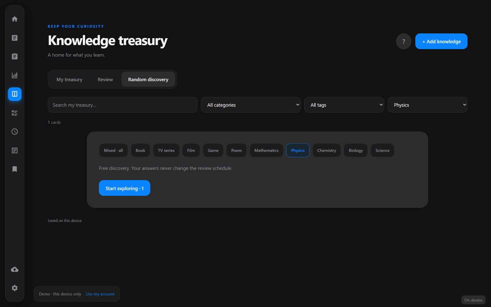

# Procats

Personal study planning and knowledge management across Android, Windows and the web. Developed by **Batu**. Current source snapshot: **1.7.4**.



Procats combines day-by-day tasks, focus timers, quick notes, study resources, practice-exam tracking, checklists and a personal knowledge treasury. Its interface supports Turkish, English and German with shared themes across the application.

## What is implemented

- Day and task organization, completion tracking and focus history.
- Countdown, analog exam-clock and OLED timer views.
- Notes, study links and practice-exam progress charts.
- A knowledge treasury with compact cards, optional images, linked entries and overlapping subjects. One Newton card can appear under Scientists, Physics and Mathematics. The archive renders at most 36 cards per page and searches all records.
- A scheduled review inbox: correct answers progress through 1, 3, 7 and recurring 30-day intervals; Hard or Forgot restarts tomorrow. Random discovery has independent subject filters and never changes this schedule.
- An account-scoped device journal, offline edits, revision-based Firestore synchronization and explicit conflict handling.
- Authenticated encrypted backups, import validation and a standalone offline recovery tool.
- Android home-screen widgets and a companion Wear OS task application.
- A Windows Electron shell using the same web interface.

## Architecture

| Folder | Purpose |
|---|---|
| `Procats/public` | Shared HTML, CSS and JavaScript interface; data validation, account journal and sync modules |
| `Procats/android` | Capacitor Android app, native timer/widget integration, shared companion code and Wear OS app |
| `Procats/tests` | Node tests and local Firestore rule/adapter tests |
| `Procats/tools` | Offline encrypted-backup recovery |
| `Windows` | Electron application shell and security tests |
| `legacy` | Preserved original desktop prototype |

The knowledge archive uses a separate manifest and four atomically updated Firestore documents; it does not change the existing task document contract. Native journal writes and account-scoped recovery protect pending edits. Conflicting changes require a user choice instead of silently replacing an answer.

## Run locally

Use Node.js 22 or newer:

```sh
cd Procats
npm ci
npm test
npm run build
npm run preview
```

Open the printed local address. The public repository contains example configuration only. You can try guest mode locally; real account sync requires your own Firebase project. Copy `public/firebase-config.example.js` to `public/firebase-config.js`, fill your own web configuration, update `.firebaserc` and `publisher.json`, and deploy your Firestore rules before connecting real accounts. The local configuration file is ignored by Git.

For rule tests, install Java 21 and run `npm run test:rules`. These use a local demo project rather than a production account.

## Android and Wear OS

Java 21 and Android SDK 36 are required. Configure `android/local.properties`, then:

```sh
npm run android:sync
cd android
./gradlew :app:assembleDebug :wear:assembleDebug
./gradlew :companion:testDebugUnitTest :app:testDebugUnitTest :wear:testDebugUnitTest
```

Debug packages use `.preview`. The signed `personal` variants use `com.procats.study.personal` so they can coexist with a store installation. `assemblePersonal` and publication builds require your own private signing configuration. Keys and passwords are deliberately absent from this repository. Phone and watch packages must share the package ID and signing certificate for Data Layer communication.

## Windows

Build `Procats/www` first, copy it to `Windows/www`, then:

```sh
cd Windows
npm ci
npm test
npm run dist
```

The Windows build produces installer and portable EXEs. Firebase Hosting updates the web client; bundled Android and Windows interfaces are updated by installing new application packages.

## Data and privacy

**This repository contains application source, example configuration and screenshots made with fictional test cards. It contains no user's tasks, notes, knowledge archive, account backup, sign-in session or signing key.**

Guest mode stores data on that device. Configured accounts use Firebase Authentication and Firestore under owner-only rules. This is not end-to-end encrypted cloud storage. Backups use AES-256-GCM with a password-derived key; the offline recovery tool can convert a backup to ordinary JSON without Firebase:

```sh
node Procats/tools/recover-backup.mjs path/to/backup.procats.json
```

The password is entered privately at the terminal. The recovered JSON is unencrypted personal data and should never be committed. Source-code history backs up the program, not an individual's application records.

## Validation

208 Node application tests, including 2,000-card pagination and offline recovery, pass in the current local snapshot. The backend rules pass 96 local authorization/sync checks; Android modules passed 42 unit/Robolectric tests and the Windows shell passed 7 tests. Desktop and mobile layouts were checked in a browser. Physical phone/watch pairing, device power management and long-term reliability are separate validation tasks; automated tests do not guarantee indefinite data retention.

See [development notes](Procats/docs/1.7.4-BILGI-HAZINESI.md) and [validation details](Procats/docs/TEST-SONUCLARI.md).
